# SWDTerm: MicroPython REPL & File Sync Over 3-Pin SWD

`SWDTerm` enables an interactive MicroPython REPL, code execution, and file synchronization on a Raspberry Pi Pico / Pico W **exclusively over the 3-pin Serial Wire Debug (SWD) port** (`SWCLK`, `GND`, `SWDIO`), without connecting the target Pico's USB port or wiring a hardware UART.

---

## 1. Motivation

By default, MicroPython on the RP2040 exposes its REPL over native USB CDC (`stdio_usb`). When developing on a target Pico that is:
- powered externally via `VSYS`,
- connected only to a **Raspberry Pi Debug Probe (CMSIS-DAP)** via the 3-pin SWD header, and
- reserving its hardware UARTs (`UART0` / `UART1`) for application use (such as `ttl2wifi`),

standard serial tools like `mpremote` have no serial port to connect to.

`SWDTerm` solves this by implementing a **shared-memory ringbuffer in RP2040 SRAM** ( kind of like SEGGER RTT, but written in pure MicroPython + Python on the host) bridged through OpenOCD's Tcl RPC interface.

---

## 2. Architecture Overview

```mermaid
flowchart LR
    subgraph Mac["Host Mac"]
        CLI["scripts/swd_repl.py<br/>(REPL / Run / Sync)"]
        OCD["OpenOCD Server<br/>(Tcl RPC :6666)"]
    end

    subgraph Probe["Debug Probe"]
        DAP["CMSIS-DAPv2<br/>(USB -> SWD)"]
    end

    subgraph PicoW["Target Pico W (RP2040)"]
        AHB["ARM Cortex-M0+ DAP<br/>(AHB-AP Bus Matrix)"]
        SCR["WATCHDOG_SCRATCH0/1<br/>(0x4005800C / 0x40058010)"]
        SHM["SRAM Ringbuffer<br/>(bytearray 1040 B)"]
        TERM["_SwdTerm(io.IOBase)<br/>(src/boot.py)"]
        REPL["MicroPython REPL<br/>(os.dupterm)"]
    end

    CLI <-->|"read_memory / write_memory"| OCD
    OCD <-->|"USB Bulk"| DAP
    DAP <-->|"3-pin SWD (5 MHz)"| AHB
    AHB <-->|"Non-intrusive SRAM R/W<br/>(CPU stays running)"| SHM
    AHB -.->|"Reads pointer & magic"| SCR
    SCR -.->|"Points to"| SHM
    SHM <--> TERM
    TERM <-->|"os.dupterm(_t)<br/>+ Timer -> dupterm_notify"| REPL
```



### Key Hardware & Runtime Mechanisms

1. **Background SRAM Access via AHB-AP (Zero CPU Halting):**
   The ARM Cortex-M0+ Debug Access Port (DAP) connects directly to the RP2040 bus fabric via an AHB-AP. OpenOCD's `read_memory` and `write_memory` Tcl commands can read and write SRAM addresses while both Cortex-M0+ cores continue executing normally at full speed.
2. **Dynamic Buffer Discovery via Watchdog Scratch Registers:**
   Because `_SwdTerm` allocates its shared `bytearray` on the MicroPython heap at boot, its SRAM address is not fixed at compile time. [src/boot.py](../src/boot.py) pins the buffer on the global `_SwdTerm` instance, retrieves its raw physical address via `uctypes.addressof(self.b)`, and writes:
   - **`0x4005800C` (`WATCHDOG_SCRATCH0`):** Physical SRAM address of `self.b` (e.g., `0x2001xxxx`).
   - **`0x40058010` (`WATCHDOG_SCRATCH1`):** Magic value `0x53574452` (`"SWDR"` in ASCII) indicating the ringbuffer is initialized and ready.
3. **Lock-Free Single-Producer / Single-Consumer Ringbuffers:**
   Neither side ever overwrites a pointer owned by the other side, avoiding race conditions between the running RP2040 CPU and asynchronous SWD memory writes.
4. **Waking the MicroPython REPL without USB Interrupts:**
   On the RP2040 port of MicroPython, `os.dupterm()` streams are only queried for input (`readinto`) when `os.dupterm_notify()` is triggered. When no USB cable is plugged into the target Pico, [src/boot.py](../src/boot.py) runs a lightweight `machine.Timer(-1)` every `15 ms` that checks `rx_head != rx_tail` in SRAM and calls `os.dupterm_notify(None)` whenever the host has pushed bytes.

---

## 3. Shared Memory Layout

The shared `bytearray` (`1040` bytes total) pointed to by `WATCHDOG_SCRATCH0` (`0x4005800C`) has the following layout:

| Byte Offset | Size | Field | Type | Written By | Read By | Description |
| :--- | :--- | :--- | :--- | :--- | :--- | :--- |
| `0x000` (`0`) | 4 B | `tx_head` | `uint32_le` | Pico W | Pico W, Host | Write index in `tx_buf` (`0..511`) |
| `0x004` (`4`) | 4 B | `tx_tail` | `uint32_le` | Host (or Pico on overflow) | Pico W, Host | Read index in `tx_buf` (`0..511`) |
| `0x008` (`8`) | 4 B | `rx_head` | `uint32_le` | Host | Pico W, Host | Write index in `rx_buf` (`0..511`) |
| `0x00C` (`12`) | 4 B | `rx_tail` | `uint32_le` | Pico W | Pico W, Host | Read index in `rx_buf` (`0..511`) |
| `0x010` (`16`) | 512 B | `tx_buf` | `uint8[512]` | Pico W | Host | Target -> Host serial output (`stdout`/`stderr`) |
| `0x210` (`528`) | 512 B | `rx_buf` | `uint8[512]` | Host | Pico W | Host -> Target serial input (`stdin`) |

### Non-Blocking Boot Behavior
If the target Pico W boots and prints output in `main.py` before the host connects, `tx_buf` could fill up. To ensure the target never blocks when the debugger is disconnected, `_SwdTerm.write()` uses overwrite-oldest semantics: if `(tx_head + 1) & 511 == tx_tail`, it advances `tx_tail` so recent boot output is preserved in the ringbuffer and ready to be drained when `swd_repl.py` connects.

---

## 4. Bootstrapping Over SWD (`deploy_swd.py`)

Because a freshly flashed MicroPython board has an empty filesystem and no SWD REPL active yet, [scripts/deploy_swd.py](../scripts/deploy_swd.py) bootstraps the filesystem directly into SPI flash over SWD:

1. Uses `littlefs-python` on the Mac to construct a **LittleFS v2.1** filesystem image matching MicroPython RP2040's exact flash geometry:
   - Flash XIP Base Address: `0x1012C000` (offset `0x12C000`, leaving `1.17 MB` for firmware and `848 KB` for LittleFS)
   - `block_size = 4096`, `block_count = 212`, `prog_size = 256`, `cache_size = 4096`, `disk_version = 0x00020001`
2. Packs `src/boot.py` and `src/main.py` into the LittleFS image.
3. Flashes the image to `0x1012C000` via OpenOCD (`program firmware/lfs_image.bin 0x1012c000 verify reset exit`).
4. Upon reset, MicroPython mounts the LittleFS partition, executes `boot.py`, initializes `_SwdTerm`, and writes its SRAM address to `0x4005800C`.

---

## 5. Host Workflows (`scripts/swd_repl.py` & `Makefile`)

Once `boot.py` is on the Pico W, day-to-day development does not need to re-flash LittleFS. [scripts/swd_repl.py](../scripts/swd_repl.py) automatically starts a background OpenOCD process if one isn't running, connects to `127.0.0.1:6666`, reads the buffer address from `0x4005800C`, and supports four modes:

### Interactive REPL
```sh
make repl
# or: .venv/bin/python3 scripts/swd_repl.py
```
Puts the local terminal into raw mode, forwards keystrokes into `rx_buf`, and streams `tx_buf` to stdout. Press `Ctrl-]` to disconnect.

### Run a Script Directly in RAM (`Raw REPL`)
```sh
make run
# or: .venv/bin/python3 scripts/swd_repl.py --run src/main.py
```
Enters MicroPython's **Raw REPL mode** (`Ctrl-A`), transmits the contents of `src/main.py`, triggers execution (`Ctrl-D`), streams `stdout`/`stderr` until completion, and exits back to the friendly REPL (`Ctrl-B`).

### Fast File Upload Over SWD Ringbuffer
```sh
make sync
# or: .venv/bin/python3 scripts/swd_repl.py --put src/main.py main.py
```
Encodes the local file in base64 and writes it directly to `:main.py` on the Pico W's mounted LittleFS filesystem using a Raw REPL command (~1 second, no flash sector erase of the whole partition required).

### One-Liner Command Execution
```sh
.venv/bin/python3 scripts/swd_repl.py -c "import os; print(os.listdir())"
```

